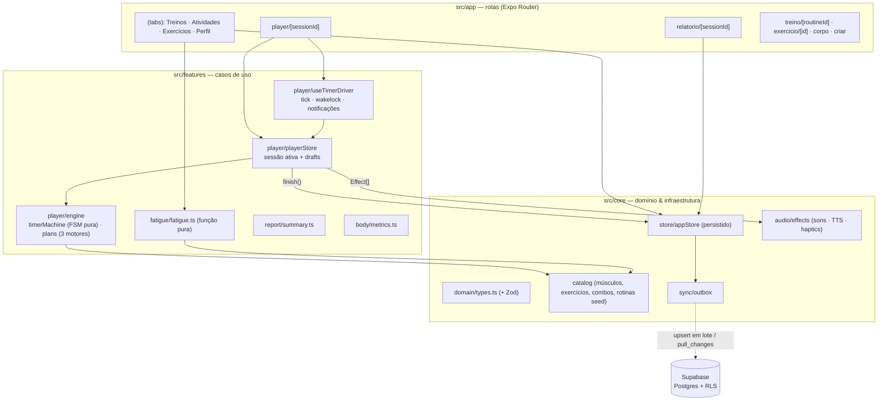
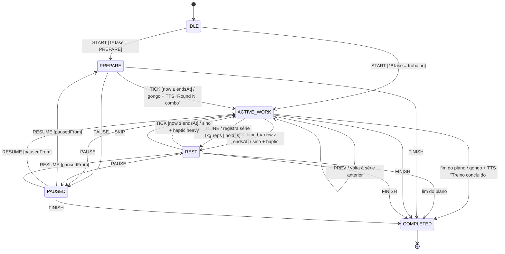

# Treine — Arquitetura Técnica

> App mobile de registro, execução guiada e monitoramento de treinos de **Musculação**, **Artes Marciais** e **Calistenia** sobre uma plataforma única (perfil, calendário, catálogo anatômico, fadiga muscular, biometria) com um **Workout Player polimórfico**.
>
> Este documento descreve o MVP implementado neste repositório (Expo SDK 58) e o caminho até a V2. Referência visual: `desing/` (design system *Kinetic Amber*).

---

## 1. Arquitetura de Software & Stack

### 1.1 Decisão de stack

| Camada | Escolha | Por quê |
|---|---|---|
| App | **Expo SDK 58 + React Native 0.88 + TypeScript strict** | Um código para iOS/Android/Web, OTA updates (EAS Update), módulos nativos oficiais para tudo que o player exige (áudio, TTS, wakelock, haptics, notificações). Node já disponível na máquina; Flutter exigiria outro toolchain. |
| Navegação | **Expo Router** (`src/app/`), `expo-router/js-tabs` + Stack | Rotas por arquivo, deep links (`treine://player/<id>`), tab bar customizável no tema. |
| Estado | **Zustand** + `persist` | Store mínimo, síncrono, fácil de persistir e de testar fora do React. |
| Persistência local | **AsyncStorage** (MVP) → **expo-sqlite** (V2) | Ver §1.3. |
| Validação | **Zod** | Valida os payloads JSONB (`prescription`, `result`) no device antes de gravar/sincronizar. |
| Backend | **Supabase** (Postgres 15, Auth, RLS, RPC) | SQL real para o modelo polimórfico, RLS por usuário, `pull_changes` incremental. |
| Áudio | **expo-audio** (sons) + **expo-speech** (TTS pt-BR) | `expo-av` não existe mais no SDK 58. |
| Tela ativa | **expo-keep-awake** (`useKeepAwake('treine-player')`) | Tela não apaga durante o treino. |
| Background | **expo-notifications** (alertas locais agendados) | JS é suspenso em background; o SO entrega o "fim do descanso". |
| Feedback | **expo-haptics** | Vibração em fim de série, contagem, meta de hold. |
| Gráficos/anatomia | **react-native-svg** | Anel de progresso, silhueta anatômica tocável, linhas e barras. |

### 1.2 Visão de camadas (feature-first + clean)



Regras: `core/` não importa `features/`; a FSM e o algoritmo de fadiga são **funções puras** sem React e sem I/O (testáveis com Jest, executáveis no servidor se necessário).

### 1.3 Offline-first

1. **O device é a fonte da verdade.** Toda escrita vai primeiro para o store local persistido (`treine/app/v1`), e o app nunca espera rede.
2. **IDs gerados no cliente** (UUID v4 em `core/utils/id.ts`): uma sessão criada offline já tem o id definitivo, então reenviar é idempotente (`upsert`).
3. **Outbox** (`core/sync/outbox.ts`): cada mutação vira `{table, op, payload, clientRev}`, compactada por `(tabela,id)`. `drain(transport)` envia em lotes de 200 quando houver sessão Supabase. Depois, `rpc('pull_changes', { since })` traz o delta por `updated_at`.
4. **Conflitos:** last-write-wins por `updated_at`. Sessões `completed` são imutáveis no servidor (só `rpe/photo/notes` mudam).
5. **Player resiliente:** o estado do timer é persistido (`treine/player/v1`) e baseado em **timestamps absolutos**. Se o app for morto no meio de um round, ao reabrir o próximo `TICK` alcança o relógio real (§3.4).

**Evolução V2 (Sprint 4):** trocar `AsyncStorage` por **expo-sqlite** com tabelas espelhando o Postgres. O `zustand/persist` aceita qualquer `StateStorage`, e `expo-sqlite/kv-store` é drop-in. O schema relacional local entra quando o histórico passar de ~2 000 sessões ou quando forem necessárias queries agregadas no device.

### 1.4 Áudio, TTS e background

| Situação | Comportamento |
|---|---|
| App em primeiro plano | `setInterval` de 200 ms → `dispatch(TICK)`. A FSM emite `Effect[]` e `runEffects` toca o som pré-carregado (`createAudioPlayer`, reuso com `seekTo(0)`), fala com `Speech.speak(text, { language: 'pt-BR', rate })` e vibra. |
| Modo silencioso (iOS) | `setAudioModeAsync({ playsInSilentMode: true, shouldPlayInBackground: true, interruptionMode: 'duckOthers' })`: a música do usuário abaixa durante o gongo e a voz. |
| Tela bloqueada / background | Ao sair do foreground, `schedulePhaseAlerts()` agenda **notificações locais** para as próximas 6 transições automáticas (fim do descanso, início do round N, fim do treino). Ao voltar, elas são canceladas e o `TICK` faz *catch-up* **sem tocar áudio atrasado** (cues com mais de 1,5 s de atraso são descartados). |
| Wakelock | `useKeepAwake` enquanto o player está montado. No uso real com luvas o app fica em foreground e o TTS narra tudo. |
| Limitação conhecida | Com a tela bloqueada, **as falas de combo no meio do round não tocam** (JS suspenso). Solução V2: gerar com antecedência uma **faixa de áudio do round** (TTS → arquivo + gongos) e tocá-la como mídia de background com `setActiveForLockScreen`. Esse é o padrão dos apps de timer de luta. |

`app.json` já declara `UIBackgroundModes: ["audio"]`, o plugin `expo-audio` com `enableBackgroundPlayback` e o plugin `expo-notifications`. TTS, sons, haptics e notificações **precisam de development build** (`npx expo run:android|ios`) ou de Expo Go em aparelho físico. No web só há fallback parcial.

---

## 2. Modelagem de Banco (PostgreSQL / Supabase)

Arquivo completo: [`supabase/migrations/0001_init.sql`](../supabase/migrations/0001_init.sql).

### 2.1 Estratégia polimórfica

Uma única hierarquia relacional serve às 3 modalidades. O que varia fica em **uma coluna JSONB tipada por linha**, discriminada pela coluna `modality`:

```
routines ─< routine_days ─< routine_items.prescription (JSONB: receita)
sessions ─< session_entries.result (JSONB: o que foi executado)
                         └─ muscle_stimuli (eventos de fadiga, append-only)
exercises ─< exercise_muscles >─ muscle_groups (τ de recuperação)
```

| Modalidade | `routine_items.prescription` | `session_entries.result` |
|---|---|---|
| strength | `{"sets":[{"reps":10,"kg":60,"rest_s":90,"rpe":8}]}` | `{"reps":8,"kg":80,"rpe":8.5}` |
| martial | `{"rounds":10,"work_s":180,"rest_s":60,"prepare_s":10,"combo_ids":[…],"callout_every_s":12,"randomize":false}` | `{"work_s":180,"combo_ids":[…],"freestyle":false,"intensity":0.8}` |
| calisthenics | `{"sets":[{"mode":"hold","target_s":30,"rest_s":120,"level":4,"load_kg":0}],"circuit":{"kind":"emom","minutes":10}}` | `{"mode":"hold","hold_s":28,"target_s":30,"level":4,"load_kg":-10}` |

Garantias de integridade em três camadas:

1. **`CHECK` por modalidade** no Postgres (ex.: `session_entries_result_shape` exige `reps ≥ 0 e kg ≥ 0` para strength e `mode ∈ {reps,hold}` para calistenia).
2. **Zod** no app (`core/domain/types.ts`: `Prescription`, `EntryResult`, uniões discriminadas por `kind`).
3. **Colunas comuns tipadas** (`modality`, `block_index`, `entry_index`, `completed_at`, `stimulus`) para que listas, calendário e fadiga **nunca precisem abrir o JSONB**.

Por que não uma tabela por modalidade? Triplicaria `sessions/entries`, o sync e os relatórios. O JSONB tipado mantém **um** código de sync, **um** histórico e **um** cálculo de fadiga, e o `summary` desnormalizado (JSONB com GIN `jsonb_path_ops`) cobre os agregados por modalidade.

### 2.2 Schema

```sql
-- (trechos centrais; o arquivo completo inclui tipos, triggers, RLS e RPC)
create type modality      as enum ('strength', 'martial', 'calisthenics');
create type tracking_mode as enum ('reps', 'hold', 'round', 'reps_or_hold');

create table muscle_groups (
  id text primary key, name_pt text not null,
  region text not null check (region in ('upper','core','lower','full')),
  views body_view[] not null, svg_path_ids text[] not null default '{}',
  recovery_tau_h numeric(5,1) not null check (recovery_tau_h between 6 and 72),
  size_factor numeric(3,2) not null default 1.0
);

create table sessions (
  id uuid primary key,                          -- gerado offline no device
  user_id uuid not null references auth.users(id) on delete cascade,
  routine_day_id uuid references routine_days(id) on delete set null,
  modality modality not null, title text not null,
  status session_status not null default 'in_progress',
  started_at timestamptz not null, ended_at timestamptz,
  active_seconds integer not null default 0, rest_seconds integer not null default 0,
  perceived_rpe numeric(3,1), photo_url text, notes text,
  summary jsonb not null default '{}'::jsonb check (jsonb_typeof(summary) = 'object'),
  client_rev bigint not null default 0,
  created_at timestamptz not null default now(), updated_at timestamptz not null default now(),
  deleted_at timestamptz,
  constraint sessions_time_order check (ended_at is null or ended_at >= started_at)
);
create index sessions_user_started_idx on sessions (user_id, started_at desc) where deleted_at is null;
create index sessions_user_updated_idx on sessions (user_id, updated_at);          -- pull incremental
create index sessions_summary_gin     on sessions using gin (summary jsonb_path_ops);

create table session_entries (
  id uuid primary key,
  session_id uuid not null references sessions(id) on delete cascade,
  user_id uuid not null references auth.users(id) on delete cascade,
  exercise_id uuid references exercises(id),
  modality modality not null, block_index smallint not null, entry_index smallint not null,
  kind tracking_mode not null, completed_at timestamptz,
  result jsonb not null, stimulus numeric(6,2) not null default 0,
  unique (session_id, block_index, entry_index),
  constraint session_entries_result_shape check (
    jsonb_typeof(result) = 'object' and
    case modality
      when 'strength'     then (result->>'reps')::int >= 0 and (result->>'kg')::numeric >= 0
      when 'martial'      then (result->>'work_s')::int > 0
      when 'calisthenics' then (result->>'mode') in ('reps','hold')
    end)
);

-- Fadiga: eventos append-only + view calculada no servidor
create table muscle_stimuli (
  id bigint generated always as identity primary key,
  user_id uuid not null, session_id uuid not null references sessions(id) on delete cascade,
  muscle_id text not null references muscle_groups(id),
  occurred_at timestamptz not null, load numeric(6,2) not null check (load >= 0),
  unique (session_id, muscle_id)
);
create view muscle_fatigue_now with (security_invoker = true) as
select s.user_id, s.muscle_id,
       least(100, sum(s.load * exp(-extract(epoch from (now() - s.occurred_at)) / 3600.0
                                   / m.recovery_tau_h)))::numeric(5,1) as fatigue_pct
from muscle_stimuli s join muscle_groups m on m.id = s.muscle_id
where s.occurred_at > now() - interval '7 days'
group by s.user_id, s.muscle_id;
```

A migração [`0002_schedule_hybrid.sql`](../supabase/migrations/0002_schedule_hybrid.sql) adiciona:
- `scheduled_workouts` (agendamento por data), com RLS e a view `scheduled_workouts_status`;
- `routines.is_hybrid` e `sessions.is_hybrid`;
- `routine_items.circuit_rounds` e `routine_items.circuit_rest_s` para ciclos (`block_kind = 'circuit'`);
- o `pull_changes` atualizado.

Também estão no arquivo: `profiles`, `exercises` (CHECK de `attributes` por modalidade e índice trigram para busca), `exercise_muscles`, `progression_steps` (árvore de calistenia), `combos`, `routines/routine_days/routine_items` (CHECK de `prescription`), `body_measurements` e `body_goals`, **RLS em todas as tabelas** (catálogo global é só leitura) e a RPC `pull_changes(since)`.

---

## 3. Máquina de Estados do Timer

Implementação: [`src/features/player/engine/timerMachine.ts`](../src/features/player/engine/timerMachine.ts), com testes em `__tests__/timerMachine.test.ts`.

### 3.1 Modelo

- **Estados:** `IDLE`, `PREPARE`, `ACTIVE_WORK`, `REST`, `PAUSED`, `COMPLETED`.
- **Plano:** cada motor compila o treino numa lista linear de `PhaseSpec { kind, durationMs | null, targetMs?, autoAdvance, countdownBeeps?, onEnter: Effect[], cues: Cue[], ref }`.
  - `durationMs = null` define uma fase **aberta** (cronômetro progressivo, termina com `SET_DONE`).
  - `targetMs` define a meta de uma fase aberta (hold): toca o sino ao atingir, sem encerrar.
- **Relógio:** `phaseStartedAt` e `endsAt` absolutos, e `PAUSE/RESUME` deslocam ambos pelo tempo pausado. Restante = `endsAt − now`, sem nenhum decremento.
- **Saída:** `transition(state, event) → { state, effects }`. A FSM não toca som nem fala. Quem executa os `Effect[]` é o driver.

### 3.2 Diagrama



### 3.3 Eventos

| Evento | Efeito |
|---|---|
| `START` | Entra na fase 0 e marca `sessionStartedAt`. |
| `TICK(now)` | *Catch-up*: enquanto `now ≥ endsAt` e `autoAdvance`, conclui a fase (`reason: 'timeout'`) e entra na próxima **com início = endsAt anterior** (sem deriva). Depois dispara os cues vencidos. |
| `SET_DONE` | Conclui a fase atual (`reason: 'done'`). O player transforma isso em `session_entry`. |
| `SKIP` | Igual, com `reason: 'skip'`. Um trabalho de musculação pulado não é registrado. |
| `PAUSE` / `RESUME` | Congela o relógio e o retoma deslocando `phaseStartedAt` e `endsAt`. |
| `ADJUST(±ms)` | Fase cronometrada: move `endsAt` (mínimo 1 s à frente). Fase aberta com meta: move `targetMs` (mínimo 5 s). **Rearma** os cues que voltaram a ficar no futuro. |
| `PREV` | Volta à fase de trabalho anterior. |
| `FINISH` | Encerra (inclusive a partir de `PAUSED`, contabilizando a pausa). |
| `RESET` | Volta a `IDLE` com o mesmo plano. |

### 3.4 Gatilhos de áudio e vibração

| Gatilho | Musculação | Artes marciais | Calistenia |
|---|---|---|---|
| Entrar em trabalho | TTS do nome (1ª série); sino + haptic heavy (próximas) | **gongo** + haptic heavy + TTS "Round N. *callout*" | TTS do nome; sino; EMOM: gongo + "Minuto N" |
| Durante o trabalho | — | TTS do combo a cada `calloutEveryS` (cue `elapsed`) | **sino + haptic success + "Meta atingida"** ao chegar em `targetMs` |
| Restam 10 s | aviso duplo + haptic warning (descansos > 15 s) | aviso duplo + haptic warning | idem |
| Restam 3, 2, 1 s | bipe | bipe | bipe |
| Entrar em descanso | haptic medium | sino + "Fim do round N. Descanse." | haptic medium |
| Fim do plano | gongo + haptic success + TTS | idem | idem |

**Regra anti-spam:** num *catch-up* que pula várias fases (app volta do background), só o áudio da transição *corrente* toca. Cues atrasados mais de `STALE_CUE_MS = 1500` ms são marcados como disparados, mas ficam mudos. Se houver várias falas no mesmo tick, `runEffects` fala apenas a última.

### 3.5 Os três motores (`plans.ts`)

Todo plano montado por `buildPlan` começa com **um único `PREPARE(10 s)`** ("Prepare-se! Primeiro: …"), em qualquer modalidade. O `START` é disparado pelo botão "Iniciar Treino" do preview, e o player cobre a tela com o `PrepareOverlay`, que pode ser pausado ou pulado.

- **A — Musculação:** `[W(aberto) → R(rest_s)] × séries`, sem descanso após a última série. Entre exercícios usa o `rest_s` da última série. Inputs (kg, reps) ficam em *drafts* por `(bloco, série)`. A edição é feita com **toque longo** no card da série (bottom sheet com reps e kg, e a opção "aplicar às séries seguintes"); séries já concluídas são corrigidas via `updateEntry`. O botão **Pausar Treino** (`PAUSE`/`RESUME`) congela a série, o descanso e o relógio total. Saída: tonelagem `Σ kg × reps`.
- **B — Artes marciais:** `[W(work_s, auto) → R(rest_s, auto)] × rounds`. O combo de cada round é **fixo da lista** ou **sorteado com PRNG determinístico** (mulberry32, seed = início da sessão), de modo que o plano é reprodutível após restaurar o app. O botão de dado é o **gerador aleatório** (fala um combo na hora) e `freestyle: true` faz rounds livres. A intensidade do round (Técnica 0,6 / Moderada 0,8 / Alta 1,0) alimenta a fadiga.
- **C — Calistenia:** hold = `W(aberto, targetMs)` progressivo com meta, reps = `W(aberto)`. Alterna **Isometria ↔ Repetições** por série, com **Nível** (1–N da árvore) e **Lastro (+kg) / Assistência (−kg)** aplicados da série atual em diante. **EMOM** = `N × W(60 s, auto)` e **AMRAP** = `W(N min)` com cues de minuto (o campo da prescrição se chama `timed`).
- **C′ — Ciclo (circuito):** itens consecutivos com o mesmo `circuit.id` (`{ rounds, restS }`). `buildCircuitPlan` gera `for volta: for exercício: W(aberto)`, **sem REST entre exercícios**, e um `REST(restS)` só ao fim de cada volta (exceto a última). `ref` carrega `circuitId / circuitRound / circuitPos / circuitSize`, e a entrada fica com `entryIndex = volta − 1`. A view troca "Progressão de séries" pela lista do **Ciclo**, e o botão vira "Próximo exercício" / "Concluir volta".
- **Híbrido:** uma ficha pode misturar modalidades (`routine.isHybrid`). O player escolhe a view pelo `prescription.kind` do **bloco atual**, então a sessão troca de motor no meio (Supino → Barra fixa → Rounds de boxe). As calorias usam o MET ponderado pela fração de registros de cada modalidade.

---

## 4. Algoritmo de Fadiga Muscular

Implementação: [`src/features/fatigue/fatigue.ts`](../src/features/fatigue/fatigue.ts) (função pura), com testes em `__tests__/fatigue.test.ts`.

### 4.1 Fórmulas

**(1) Estímulo bruto por registro** $E$ (pontos; uma "série dura" típica ≈ 12):

- **Musculação:**
$$E = 12 \cdot I_{RPE} \cdot V,\quad I_{RPE} = \mathrm{clamp}\!\left(0{,}6 + 0{,}6\,\frac{RPE-5}{5},\ 0{,}4,\ 1{,}2\right),\quad V = \mathrm{clamp}\!\left(0{,}5 + 0{,}5\,\frac{kg\cdot reps}{BW\cdot 8},\ 0{,}5,\ 1{,}4\right)$$
  (RPE padrão 8; BW = peso corporal mais recente)
- **Artes marciais:**
$$E = \frac{work_s}{60}\cdot 4 \cdot \mathrm{clamp}(intensidade,\ 0{,}2,\ 1)$$
- **Calistenia:**
$$E = 12 \cdot L \cdot C \cdot W,\quad L = 0{,}6 + 0{,}1\cdot nível,\quad C = \mathrm{clamp}\!\left(1 + \frac{lastro_{kg}}{\max(BW,30)},\ 0{,}4,\ 1{,}8\right)$$
$$W_{hold} = \mathrm{clamp}\!\left(\frac{hold_s}{20},\ 0,\ 1{,}5\right),\qquad W_{reps} = \mathrm{clamp}\!\left(\sqrt{\frac{reps}{8}},\ 0,\ 1{,}4\right)$$

**(2) Distribuição por músculo**, com papel $w$ (primário 1,0, secundário 0,5, estabilizador 0,25) e ativação $a \in [0,1]$ de `exercise_muscles`:
$$E_m = E \cdot w_{role} \cdot a$$

**(3) Carga da sessão por músculo**, normalizada pelo tamanho do músculo $s_m$ (quadríceps 1,5 · antebraço 0,6):
$$L_m = \min\!\left(100,\ \frac{\sum E_m}{s_m}\right)$$

**(4) Fadiga no instante $t$** (decaimento exponencial, sessões dos últimos 7 dias):
$$F_m(t) = \min\!\left(100,\ \sum_i L_{m,i}\, e^{-(t-t_i)/\tau_m}\right),\qquad \tau_m = \frac{T_m}{\ln(100/30)}$$

$T_m \in \{24, 48, 72\}$ h é o tempo de recuperação do grupo: antebraço, panturrilha e abdômen 24 h; peito, ombros e braços 48 h; dorsal, quadríceps, posteriores, glúteos e lombar 72 h. Com isso, **sair de 100 % e chegar a 30 % leva exatamente $T_m$** (verificado em teste).

**(5) Tempo restante até recuperar:** $t_{rec} = \tau_m \ln(F/30)$.

**(6) Estados (cores da silhueta):**

| Faixa | Estado | Cor |
|---|---|---|
| F < 30 % | Recuperado | verde `#2bb673` |
| 30–55 % | Em recuperação | âmbar `#f2b822` |
| 55–80 % | Enfraquecido | laranja `#f28522` |
| ≥ 80 % | Fadigado | vermelho `#e5484d` |

### 4.2 Calibração (casos de teste)

- 8 séries de supino a 80 kg × 8, RPE 9, BW 80 → peitoral **> 80 %** (Fadigado), tríceps menor e quadríceps intacto.
- Esse mesmo peitoral 50 h depois → **Recuperado**.
- 10 rounds de 3 min a 0,8 → $E = 9{,}6$ por round. No deltoide anterior (a = 0,8, s = 0,8) a sessão satura em ~96 %.
- Hold de front lever com +10 kg > sem lastro > com −20 kg de assistência.

### 4.3 Estrutura de dados

- **Device:** `computeFatigue(sessions, BW, now)` recalcula sob demanda (17 músculos × ~30 sessões, menos de 1 ms). Não há cache persistido.
- **Servidor:** ao concluir uma sessão grava-se uma linha em `muscle_stimuli(session_id, muscle_id, occurred_at, load = L_m)`, e a view `muscle_fatigue_now` aplica a mesma exponencial no Postgres (para web, dashboards e notificações push do tipo "seu peito está recuperado").

---

## 5. Estrutura de Pastas & Backlog

### 5.1 Diretórios

```
Treine/
├─ app.json · package.json · tsconfig.json
├─ assets/sounds/             gong · bell · beep · beep_final · warning (WAV gerados por scripts/gen-sounds.js)
├─ desing/                    referência visual (Kinetic Amber + 10 telas)
├─ docs/ARQUITETURA.md
├─ supabase/migrations/0001_init.sql
├─ scripts/gen-sounds.js
└─ src/
   ├─ app/                    ROTAS (só telas)
   │  ├─ _layout.tsx          fontes, splash, tema, Stack raiz
   │  ├─ (tabs)/_layout.tsx   Treinos · Atividades · Exercícios · Perfil
   │  ├─ (tabs)/index.tsx     Home dashboard
   │  ├─ (tabs)/atividades.tsx  fadiga + resumo mensal + histórico/calendário
   │  ├─ (tabs)/exercicios.tsx  catálogo, filtros, seletor anatômico
   │  ├─ (tabs)/perfil.tsx    perfil, composição, metas, preferências
   │  ├─ player/[sessionId].tsx  player polimórfico
   │  ├─ relatorio/[sessionId].tsx
   │  ├─ treino/[routineId].tsx · exercicio/[id].tsx · corpo.tsx · criar.tsx
   ├─ core/
   │  ├─ domain/types.ts      tipos + Zod (espelho do SQL)
   │  ├─ catalog/             músculos, exercícios, combos, rotinas seed
   │  ├─ store/               appStore (persist), demoData
   │  ├─ sync/outbox.ts
   │  ├─ audio/effects.ts
   │  ├─ theme/tokens.ts      Kinetic Amber
   │  └─ utils/
   ├─ features/
   │  ├─ player/engine/       timerMachine.ts · plans.ts · __tests__
   │  ├─ player/views/        StrengthPlayer · MartialPlayer · CalisthenicsPlayer · common
   │  ├─ player/playerStore.ts · useTimerDriver.ts
   │  ├─ fatigue/ · report/ · body/ · workouts/
   └─ shared/components/      ui (Card, PillButton, Chip, Stepper…), Screen, charts, AnatomyBody
```

### 5.2 Backlog (MVP → V2)

| Sprint | Objetivo | Entregas | Status |
|---|---|---|---|
| **1 — Fundação** | Plataforma navegável | Expo Router + 4 abas, design system Kinetic Amber, tipos/Zod, catálogo seed (37 exercícios, 12 combos, 3 rotinas), store offline persistido, Home, criador de treino | ✅ neste repo |
| **2 — Motores** | Treinar de verdade | FSM do timer + 19 testes, motores A/B/C, drafts de carga/reps/nível/lastro, substituição de exercício, notas, TTS/sons/haptics, wakelock, alertas em background, relatório pós-treino com foto/RPE/checklist | ✅ neste repo |
| **3 — Inteligência** | Ver o progresso | Algoritmo de fadiga + silhueta 4 estados, fadiga por região, resumo mensal, calendário, biometria (peso × meta, IMC, faixa ideal, % gordura, circunferências, gráfico) | ✅ neste repo |
| **4 — Nuvem (V2)** | Conta e multi-device | Supabase Auth (e-mail/Apple/Google) · migração 0001 · transporte do `outbox` + `pull_changes` · upload de foto no Storage · expo-sqlite local · faixa de áudio pré-renderizada para TTS com tela bloqueada · HealthKit/Health Connect (FC na tela de luta) · EAS Build/Update | 🔜 |

### 5.3 Atualização v1.1 (UX)

| Área | Entrega |
|---|---|
| Home | Toque em qualquer dia da faixa semanal → `/calendario` (modal). O calendário mensal mostra os treinos feitos (pontos por modalidade) e os **agendados** (borda tracejada), e permite **agendar por data** (`ScheduledWorkout`, migração `0002`). O "Próximo treino" usa o agendado de hoje. A **frase motivacional do dia** (`quoteOfDay`, rotação por dia do ano) substitui a linha de consistência. O **sino** abre `/avisos`, com avisos gerados de forma pura (`buildNotices`: agendados, músculos recuperados, peso desatualizado, sequência, treino em andamento) e um ponto de não lido. |
| Pré-treino | Todos os caminhos passam pelo **preview** (`treino/[routineId]`) antes de iniciar. Os treinos rápidos abrem `/modalidade/[modality]` com as fichas salvas, e o "Treino livre" fica no fim da lista. Há contagem de 10 s antes do 1º exercício ou round. |
| Construtor | As abas viram só **filtro** do catálogo. Cada exercício tem **"+ Adicionar"** e o **"Salvar Treino"** fica fixo no rodapé. Dá para montar **rotinas híbridas**, reordenar e unir itens de calistenia em **ciclos** (voltas e descanso no fim). |
| Player | Musculação: **Pausar Treino** e **edição por toque longo**. Calistenia: **modo Ciclo**. |

Itens V2 adicionais: editor completo de rotinas (múltiplos dias, reordenar, supersets), árvores de progressão com desbloqueio automático, PR por exercício com gráfico, compartilhamento social, widgets e Live Activities do timer, i18n.

---

### 5.4 Catálogo de exercícios (em 3 fases)

| Fase | Modalidade | Conteúdo | Arquivos |
|---|---|---|---|
| 1 ✅ | Musculação | **150 exercícios** (149 cadastros: o nº 139 "Supino fechado no Smith" é o mesmo do nº 9) em máquinas articuladas, Smith e polias, organizados em 8 grupos (Peitoral 20, Costas 25, Ombros 22, Pernas 35, Panturrilhas 8, Bíceps 16, Tríceps 14, Core 10). Cada um traz músculos (primário/secundário/estabilizador com ativação), nível, equipamento, descanso padrão e uma dica de execução. | `src/core/catalog/strength.ts` |
| 2 ✅ | Calistenia | **150 exercícios de peso corporal** da [free-exercise-db](https://github.com/yuhonas/free-exercise-db) (domínio público), cobrindo peito, costas, ombros, tríceps, core, pernas, pliometria e mobilidade. Cada um tem nome, dica e **passo a passo em português** e **animação** (as fotos da posição inicial e final se alternam com crossfade). | `calisthenics.ts` + `calisthenics/part1–4.ts` (PT), `calisthenics.generated.ts` e `calisthenicsMedia.ts` (gerados) |
| 3 🔜 | Artes marciais | Movimentos e combos de boxe. | `martial.ts` |

**Pipeline de mídia da calistenia:**
- `scripts/cali/selection.json` lista os 150 IDs curados;
- `npm run catalog:media` (`scripts/cali/build-media.mjs`, com `sharp`) converte as fotos em WebP de 480 px (≈ 3,75 MB no total, embutidos no app e disponíveis offline) e gera os módulos `require()`;
- o componente `ExerciseAnimation` faz a animação no player, no "Prepare-se" e no detalhe do exercício, e congela no descanso e na pausa;
- o `ExerciseThumb` mostra a miniatura nas listas;
- a licença da base fica em `assets/exercises/cali/LICENSE.txt`.

**IDs antigos:**
- `LEGACY_EXERCISE_IDS` mapeia os IDs do catálogo v1 para os novos;
- os skills que não existem na base apontam para o equivalente mais próximo (ex.: Front Lever → Pike suspenso);
- a migração do persist (v3/v4) reescreve fichas e sessões salvas.

**Backend:** `npm run catalog:sql` (`scripts/gen-catalog-sql.ts`) gera `supabase/seed/catalog.sql`:
- upsert idempotente dos 304 exercícios e de `exercise_muscles`/`muscle_groups`;
- UUID v5 a partir do slug;
- `attributes` com grupos, nº do catálogo, passos e chaves de mídia.

## Verificação

```bash
npm test           # 339 testes: catálogo (150+150, conteúdo PT, mídia, grupos, legados); FSM (3 motores, PREPARE global, ciclo, híbrido, pausa, catch-up, ajuste ±), fadiga, avisos e frase do dia
npx tsc --noEmit   # typecheck strict
npx expo start     # Expo Go / dev build; "w" abre no navegador
```

---

**Qual parte você quer detalhar primeiro?** Sugestões:
1. **Timer Engine:** faixa de áudio pré-renderizada para TTS com tela bloqueada, ou Live Activity/notificação persistente do round.
2. **Supabase:** transporte do outbox, `pull_changes`, Auth e trigger que preenche `muscle_stimuli` no servidor.
3. **Telas específicas:** editor completo de rotinas (multi-dia, supersets) ou a árvore de progressão de calistenia.
